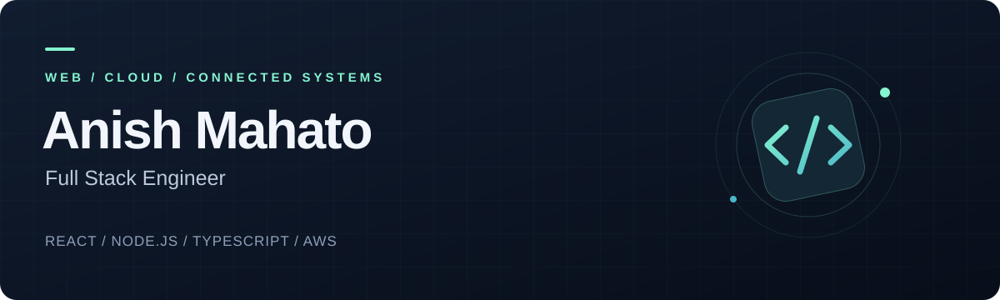

  <strong>AI home automation · Enterprise SaaS · Cloud operations</strong>

  <a href="https://anishnp.vercel.app"><strong>Explore my portfolio ↗</strong></a>
  &nbsp; / &nbsp;
  <a href="https://www.linkedin.com/in/anishpabe/">LinkedIn</a>
  &nbsp; / &nbsp;
  <a href="mailto:anishgithub890@gmail.com">Get in touch</a>

## Hi, I'm Anish — Full Stack Engineer.

Based in **Dubai, UAE**, I build web applications across the stack: product interfaces, backend services, database architecture, and cloud deployment. My experience spans **AI home automation, multi-tenant SaaS, HRMS & CRM, real estate, and ERP systems**.

At **CASABOT – AI HOME**, I contribute to an **AI-powered home automation platform** connecting smart devices, automation workflows, and conversational AI. Previously, at **Chaturvedi Software House**, I worked on business platforms covering people operations, customer relationships, property management, and finance.

I care about the details that make software useful: clear interfaces, maintainable APIs, reliable data flows, and services that are easier to operate in production.

### What I bring to a team

| Product engineering | Systems & delivery |
| :--- | :--- |
| Responsive dashboards and reusable UI components | REST APIs, third-party integrations, and real-time data flows |
| HRMS, CRM, property, and financial workflows | Multi-tenant architecture, data isolation, and role-based access |
| AI-assisted interfaces and connected-device experiences | AWS EC2, Linux, Docker, and production troubleshooting |

### Professional experience

**CASABOT – AI HOME · Full Stack Engineer** 
Dubai, UAE · February 2026 – Present

- Build dashboards and backend integrations for a connected-home platform, supporting smart devices, automation, and conversational controls.
- Work across React, Next.js, TypeScript, Node.js, and AI/IoT integrations to connect product interfaces with platform services.
- Deploy and troubleshoot services on AWS EC2, working with Linux, Docker, Amazon DocumentDB, and production logs.

**Chaturvedi Software House LLC · Full Stack Engineer** 
Dubai, UAE · 2024 – January 2026

- Developed HRMS and CRM workflows covering employee management, recruitment, payroll, leads, sales pipelines, and invoicing.
- Worked on multi-tenant SaaS architecture, database schemas, authentication, permissions, real-time updates, and reusable frontend components.
- Built property marketplace and real estate management features, including AI-assisted matching, contracts, payments, maintenance, and reporting.
- Developed backend APIs and integrations for ERP, inventory, and financial operations.

**Channakya Software Private Limited · Full Stack Engineer** 
Kathmandu, Nepal · February – November 2022

- Developed Node.js APIs, React and TypeScript interfaces, and integrations with MongoDB and MySQL; contributed to .NET e-commerce development and API testing.

**Islington College Kathmandu · Full Stack Engineer Intern** 
Kathmandu, Nepal · November 2020 – October 2021

- Contributed to mobile and backend projects using Flutter, Laravel, MySQL, and Android Java.

### Real-world engineering work

My work spans connected environments, enterprise operations, commerce, and mobile applications. These are the systems and workflows I've contributed to across my professional experience.

| Platform | My contribution | Engineering focus |
| :--- | :--- | :--- |
| **Connected Living Platform** | Dashboards, service integrations, and data flows connecting smart devices, automation rules, and conversational AI; deployment and production troubleshooting. | React · Next.js · Node.js · AWS EC2 · DocumentDB |
| **People Operations Suite** | Employee lifecycle, recruitment, attendance, leave, payroll, and people analytics within a multi-tenant HRMS. | TypeScript · Next.js · Express · Prisma · MySQL |
| **Customer Relationship Workspace** | Lead scoring and routing, contacts, deal pipelines, sales forecasting, quotes, orders, invoicing, and campaign workflows. | React · Node.js · MySQL · Redis · Socket.io |
| **Property Discovery Network** | Broker and listing workflows, buyer requirements, AI-assisted property matching, activity feeds, and third-party listing integrations. | Next.js · TypeScript · Node.js · Prisma · REST APIs |
| **Property Operations Suite** | Tenant and landlord workflows, rental and sales contracts, digital signatures, PDF documents, payments, maintenance tickets, and approval flows. | Next.js · React Query · React Hook Form · Zod · PDF tooling |
| **Finance & Inventory Hub** | Backend APIs for financial operations, inventory control, business process automation, third-party integrations, caching, and reporting. | Node.js · Express · MySQL · MongoDB · Redis |
| **Retail Billing Workspace** | Sales and returns interfaces, receipts, payment options, tax handling, customer workflows, and sales reporting. | Next.js · TypeScript · Tailwind CSS · Recharts |
| **Commerce Web Platform** | Frontend and backend contributions to a .NET-based e-commerce application, with API integration and testing across modules. | .NET · API integration · API testing |
| **Mobile & Backend Applications** | Contributions to Flutter mobile applications, Laravel backend services, and Android features during my internship. | Flutter · Laravel · PHP · MySQL · Java · Oracle |

### Technology toolkit

**Interfaces** 
React · Next.js · TypeScript · JavaScript · Tailwind CSS · shadcn/ui · React Query · Zustand

**Services & integrations** 
Node.js · Express · REST APIs · Socket.io · JWT · OAuth · AI & IoT integrations

**Data & infrastructure** 
MySQL · MongoDB · Amazon DocumentDB · Prisma · Redis · AWS EC2 · Docker · Linux · Git

<strong>Earlier experience & creative tools</strong>

Laravel · PHP · Flutter · Android Java · .NET · Three.js

---

  <strong>Let's build something useful.</strong> 
  Open to technical conversations and collaboration on web platforms, SaaS, and connected systems. 
  <a href="mailto:anishgithub890@gmail.com">anishgithub890@gmail.com</a> · <a href="https://www.linkedin.com/in/anishpabe/">LinkedIn</a> · <a href="https://anishnp.vercel.app">Portfolio</a>

